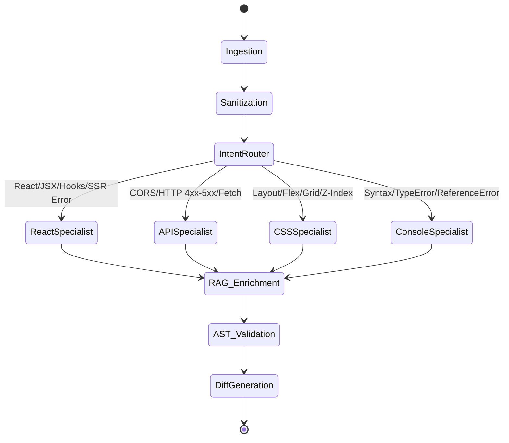

# 🏛️ FrontFix AI — System Architecture Specification
> **Team B (Frontend Support Chatbot) — Architectural Blueprint & Technical Design**

---

## 1. Architectural Philosophy

FrontFix AI is architected as an **Agentic, Context-Aware Diagnostic Pipeline**. Unlike basic conversational chatbots that simply forward user text to an LLM, FrontFix AI executes a multi-stage deterministic and cognitive triage:

```
[Developer Console / Code Snippet / Error Event]
                       │
                       ▼
            ┌──────────────────────┐
            │  Input Sanitization  │  <-- Strips JWTs, Secrets, PII
            └──────────┬───────────┘
                       │
                       ▼
            ┌──────────────────────┐
            │  Classifier & Router │  <-- Deterministic Regex + LangGraph Router
            └──────────┬───────────┘
                       │
         ┌─────────────┼─────────────┬─────────────┐
         ▼             ▼             ▼             ▼
   [React Agent]  [API Agent]   [CSS Agent]  [Console Agent]
         │             │             │             │
         └─────────────┼─────────────┴─────────────┘
                       │
                       ▼
            ┌──────────────────────┐
            │ Vector RAG Retrieval │  <-- MDN Docs, React 19 RFC, CanIUse
            └──────────┬───────────┘
                       │
                       ▼
            ┌──────────────────────┐
            │ Solution Synthesizer │  <-- AST Validation & Code Diff Generator
            └──────────┬───────────┘
                       │
                       ▼
        [Interactive Diagnostic Response Card]
```

---

## 2. Component Specifications

### 2.1. Client & Ingestion Layer
1. **Interactive Web Workspace**:
   - Built with modern React and Tailwind CSS.
   - Dual-mode interface: Natural Language Chat + Error Stack Analyzer.
   - Monaco Editor / Prism.js syntax highlighter with side-by-side unified diffs (`+` addition in green, `-` removal in red).
2. **Browser Extension (Manifest V3)**:
   - Injects a lightweight listener into the developer's tab:
     - `window.addEventListener('error', ...)`
     - `window.addEventListener('unhandledrejection', ...)`
     - Monkeys-patches `window.fetch` and `XMLHttpRequest` to capture failed HTTP requests (4xx/5xx/CORS) with request headers.
   - One-click "Send to FrontFix AI" pill in the browser's developer tools panel.
3. **Vite / Next.js Plugin**:
   - Catches compile-time and fast-refresh runtime errors before they reach the user terminal.

---

### 2.2. Gateway & Privacy Shield
Frontend error logs frequently contain sensitive developer environment data (e.g., `Authorization: Bearer eyJhb...`, `.env` tokens, customer PII). 

The **Privacy Shield Middleware**:
- Runs client-side or at the API gateway before LLM inference.
- Utilizes deterministic regex masks to redact:
  - Bearer tokens (`Bearer [A-Za-z0-9-_=]+\.[A-Za-z0-9-_=]+\.?[A-Za-z0-9-_.+/=]*`) -> `[REDACTED_JWT]`
  - Cloud provider API keys (AWS `AKIA...`, OpenAI `sk-...`, GitHub `ghp_...`) -> `[REDACTED_API_KEY]`
  - IP addresses, email addresses, and passwords in JSON payloads.

---

### 2.3. Multi-Agent Diagnostic Core (LangGraph)
FrontFix AI uses **LangGraph** to route problems to domain-specialized subagents:



#### Specialized Subagents:
1. **React & Component Specialist**:
   - Deep knowledge of React 19 compiler semantics, Server Components (RSC), hydration contracts, and hook closure rules.
   - Detects infinite re-renders (`setState` invoked inside body without `useEffect`), stale closures in `useCallback`, and missing `key` props.
2. **API & Network Specialist**:
   - Diagnoses CORS preflight failures (`OPTIONS 405`), mixed content HTTP vs HTTPS blocks, authentication cookie expiration (`SameSite` attribute collisions), and payload shape mismatches.
3. **CSS & Layout Specialist**:
   - Analyzes CSS Stacking Contexts (e.g. `transform`, `filter`, `opacity < 1` creating new stacking contexts).
   - Diagnoses Flexbox item min-width clipping (`min-width: 0` fix) and CSS Grid overflow issues.
4. **Console & Runtime Specialist**:
   - Unravels minified JavaScript stack traces using `.map` source maps.
   - Pinpoints null reference exceptions, undefined evaluation, and asynchronous race conditions.

---

### 2.4. RAG (Retrieval-Augmented Generation) Knowledge Base
To eliminate hallucinations, LLM reasoning is grounded in curated technical vector embeddings:
- **Vector Database**: ChromaDB (local/embedded) or Pinecone (cloud-native).
- **Chunking Strategy**: Markdown header-based chunking with hierarchical metadata tagging (e.g. `framework: react`, `version: 19`, `api: useEffect`).
- **Indexed Knowledge Bases**:
  1. **MDN Web Docs**: Modern DOM APIs, CSS Grid/Flex specs, Fetch API, Content Security Policy (CSP).
  2. **React Official Documentation**: React 19 RFCs, Hooks reference, React DOM error codes.
  3. **Next.js & Vite Guides**: SSR hydration gotchas, App Router layout boundaries, proxy configurations.
  4. **CanIUse Database**: Modern CSS/JS feature compatibility across Chrome, Safari, Firefox, and Edge.

---

### 2.5. Solution Output & AST Code Diff Generator
Rather than raw conversational answers, FrontFix AI delivers a structured JSON payload rendered into an interactive UI card:

```typescript
interface DiagnosticResult {
  id: string;
  timestamp: string;
  errorDomain: 'REACT' | 'JAVASCRIPT' | 'CSS' | 'NETWORK' | 'DOM';
  severity: 'CRITICAL' | 'WARNING' | 'INFO';
  title: string;
  rootCause: string;
  codeDiff: {
    language: string;
    beforeSnippet: string;
    afterSnippet: string;
    explanation: string;
  };
  defensiveBestPractice: string;
  docReferences: Array<{
    title: string;
    url: string;
  }>;
}
```

---

## 3. Security, Scalability & Performance Benchmarks

| Metric | Target Goal | Strategy to Achieve |
| :--- | :--- | :--- |
| **Response Latency** | < 1.5 seconds | Streaming SSE (Server-Sent Events) + Local Regex Pre-classification |
| **Hallucination Rate** | < 2% | RAG verification with strict temperature (0.1 - 0.2) and document attribution |
| **Data Privacy** | 100% Zero-Leak | Client-side PII/Token scrubber before network transit |
| **Accuracy on Common Errors** | > 95% | Tailored few-shot prompt libraries and AST syntax validation |

---

## 4. Summary for Classroom Discussion
- **Modularity**: Every component (Sanitizer, Router, Specialized Agents, Vector DB, Diff Renderer) can be built and tested independently by team members.
- **Real-World Value**: Demonstrates an enterprise-grade architectural pattern (Multi-agent RAG + AST Code Refactoring) rather than a simple chatbot API wrapper.
