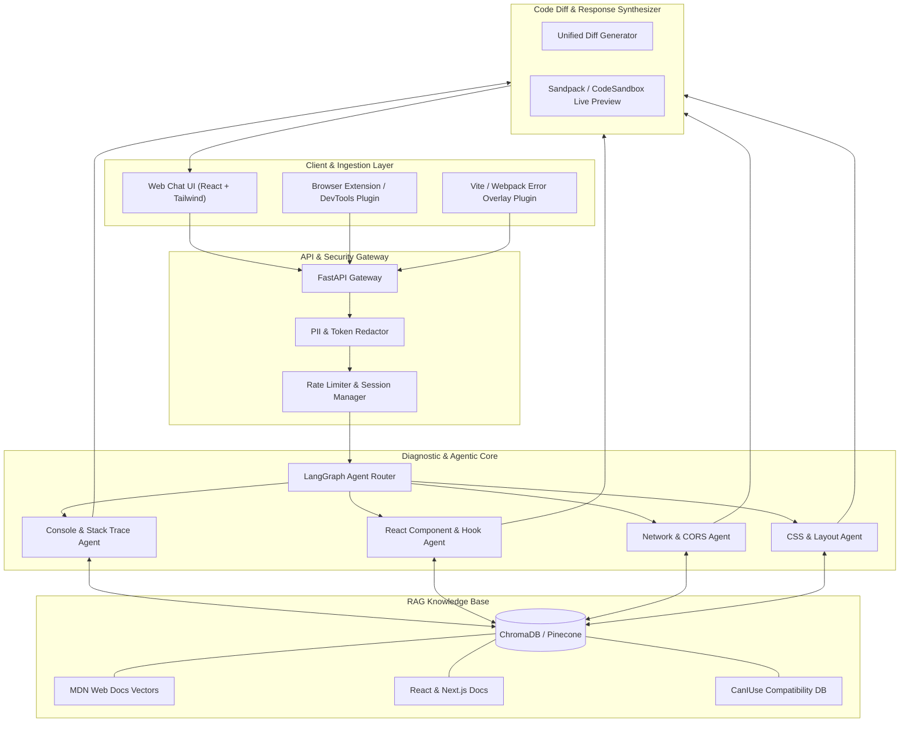

# ⚡ FrontFix AI — AI-Powered Frontend Support Chatbot
> **Team B Project:** Autonomous Diagnostics, Real-Time Console Debugging & Code Repair for Modern Web Applications.

[](https://github.com/AdnanAK8)
[-blue?style=for-the-badge&logo=react)](https://github.com/AdnanAK8)
[](https://github.com/AdnanAK8)

---

## 📌 Table of Contents
1. [Project Overview & Mission](#-project-overview--mission)
2. [Target Problem Scope](#-target-problem-scope)
3. [How FrontFix AI Works (Resolution Mechanics)](#-how-frontfix-ai-works-resolution-mechanics)
4. [Proposed System Architecture](#-proposed-system-architecture)
5. [Technology Stack](#-technology-stack)
6. [Step-by-Step Implementation Roadmap](#-step-by-step-implementation-roadmap)
7. [Real-World Problem Scenarios & Resolution](#-real-world-problem-scenarios--resolution)
8. [Classroom Discussion & Presentation Guide](#-classroom-discussion--presentation-guide)
9. [Interactive Prototype](#-interactive-prototype)
10. [Repository Structure](#-repository-structure)

---

## 🚀 Project Overview & Mission

Modern frontend development has grown substantially complex. With modern UI frameworks (React, Next.js, Vue), state management libraries (Redux, Zustand), build tooling (Vite, Webpack), and complex API contracts, developers spend up to **35-45% of their daily engineering time** deciphering cryptic browser console errors, CSS layout collisions, CORS/API integration failures, and hydration mismatches.

**FrontFix AI (Team B)** is an AI-powered conversational support engineer and automated diagnostics system specifically engineered to diagnose, explain, and resolve frontend engineering issues in real time.

Unlike general-purpose LLMs that lack environment awareness and hallucinate non-existent API fixes, **FrontFix AI** integrates:
- **Client-Side Runtime & AST Inspection**: Intelligently parses stack traces, de-minifies code via source maps, and analyzes DOM state.
- **RAG on Canonical Documentation**: Queries authoritative frontend sources including MDN Web Docs, React 19 specs, Next.js app router guides, and browser engine compatibility tables.
- **Interactive Code Patch Generator**: Delivers side-by-side unified code diffs (`Before` vs `After`) with one-click copy and sandbox preview.

---

## 🎯 Target Problem Scope

Team B's chatbot is designed to handle the full spectrum of frontend development friction:

| Category | Typical Issues Handled | Resolution Strategy |
| :--- | :--- | :--- |
| **HTML & DOM Structure** | Malformed nesting, unclosed tags, accessibility (a11y) violations, broken semantic hierarchy | DOM AST validation, ARIA attribute suggestions, semantic element replacement |
| **CSS & Responsive UI** | Flexbox/Grid overflow, z-index stacking context failures, mobile viewport clipping, unexpected layout shifts (CLS) | CSS computed style inspector, box-model breakdown, modern Tailwind/CSS solutions |
| **JavaScript & TypeScript** | `TypeError: Cannot read properties of undefined`, unhandled async rejections, closure scope traps, TS generic mismatches | Call stack trace parsing, optional chaining (`?.`), nullish coalescing (`??`), async/await pattern refactoring |
| **React & Modern Frameworks** | React 19 hydration mismatches, infinite re-render loops (`Too many re-renders`), stale state closures in `useEffect`, missing keys | Component lifecycle simulation, dependency array linting, memoization (`useMemo`/`useCallback`) recommendations |
| **Browser Console Errors** | Uncaught exceptions, CSP (Content Security Policy) blocks, deprecation warnings, mixed content errors | Regex/LLM hybrid error classifier, source map un-minification, browser engine compatibility lookup |
| **API Integration & Network** | CORS policy rejections, HTTP 400/401/403/404/422/500 errors, JSON parsing crashes, stale TanStack/SWR queries | Request/response header analysis, proxy configuration tips, error boundary implementations |

---

## 🧠 How FrontFix AI Works (Resolution Mechanics)

FrontFix AI operates via a 4-tier diagnostic pipeline:

```
[ Developer Input / Console Error / Snippet ]
                      │
                      ▼
 ┌──────────────────────────────────────────────┐
 │ 1. Ingestion & Sanitization Engine           │
 │    • Redacts API keys, JWT tokens & PII      │
 │    • Strips minification noise & extracts AST│
 └──────────────────────┬───────────────────────┘
                        │
                        ▼
 ┌──────────────────────────────────────────────┐
 │ 2. Hybrid Classification & Diagnostic Engine │
 │    • Deterministic Parser (Regex / AST)      │
 │    • Semantic Classifier (Domain & Severity) │
 └──────────────────────┬───────────────────────┘
                        │
                        ▼
 ┌──────────────────────────────────────────────┐
 │ 3. RAG Retrieval & Context Augmentation      │
 │    • Vector DB: MDN, React 19, Vite, Next.js │
 │    • StackOverflow top verified solutions    │
 └──────────────────────┬───────────────────────┘
                        │
                        ▼
 ┌──────────────────────────────────────────────┐
 │ 4. Multi-Agent Solution Synthesis            │
 │    • Root Cause Explanation (Plain English)  │
 │    • Precise Before/After Code Diff          │
 │    • Prevention Best Practices & Pro-Tips    │
 └──────────────────────────────────────────────┘
```

1. **Intelligent Ingestion & Privacy Shield**:
   The input (error stack trace, network log, or broken JSX code) is first scrubbed of sensitive environment credentials (Bearer tokens, secrets, user emails).
2. **Deterministic & AST Pre-Processing**:
   Known patterns (e.g. `Access to fetch at ... blocked by CORS policy`, `Hydration failed`) are tagged by deterministic heuristics to guide LLM reasoning.
3. **Retrieval-Augmented Generation (RAG)**:
   Embeddings match the issue against curated documentation vectors (MDN Web API specs, React 19 RFCs, Next.js 15 App Router caveats).
4. **Structured Solution Output**:
   The assistant outputs actionable cards: **Root Cause**, **Direct Code Diff**, **Underlying Mechanics**, and **Defensive Programming Rule**.

---

## 🏗️ Proposed System Architecture



---

## 💻 Technology Stack

### 1. Frontend & User Interface
- **Framework**: React 19 + TypeScript + Vite (Fast HMR, modern JSX runtime)
- **Styling**: Tailwind CSS (Utility-first, responsive dark/light developer aesthetic)
- **Syntax Highlighting & Diffs**: Monaco Editor / Prism.js & `diff-match-patch`
- **Component Icons**: Lucide React

### 2. Backend & Agent Orchestration
- **API Framework**: FastAPI (Python 3.11+) or Node.js/Express with WebSocket support for streaming responses
- **Agent Orchestrator**: LangChain / LangGraph (Multi-agent routing based on error domain)
- **Code AST Analysis**: Babel Parser / `@babel/traverse` (for syntax tree validation)

### 3. AI & Vector Knowledge Base
- **LLM Engine**: OpenAI GPT-4o / Google Gemini 1.5 Pro / Anthropic Claude 3.5 Sonnet
- **Embeddings**: `text-embedding-3-small` or HuggingFace `all-MiniLM-L6-v2`
- **Vector Database**: ChromaDB (lightweight local) or Pinecone / Qdrant (cloud production)
- **Knowledge Sources**: MDN Web Docs, React.dev official docs, Next.js documentation, CanIUse data

### 4. Telemetry & Developer Tooling
- **Browser Extension**: Manifest V3 Chrome Extension to capture `console.error` and failed `fetch` network requests automatically with one click.
- **Vite Integration**: Custom `vite-plugin-frontfix` overlay for instant terminal & browser debugging.

---

## 📅 Step-by-Step Implementation Roadmap

```
Week 1: Research, Taxonomy & Architecture Validation
├── Define error taxonomies (React, JS, CSS, Network)
├── Scrape & vectorize MDN Docs & React documentation into ChromaDB
└── Draft prompt engineering patterns & response schemas

Week 2: Diagnostic Engine & Stack Trace Parsing
├── Implement AST & stack trace regex parser
├── Build PII and auth-header sanitization middleware
└── Implement LangChain RAG pipeline with domain-specific agent prompts

Week 3: Core Chatbot UI & Monaco Diff Viewer
├── Develop clean modern Chat UI with dark mode
├── Implement side-by-side code diff visualizer
└── Build quick-action error template triggers (Hydration, CORS, TypeError)

Week 4: Real-time Browser Extension / DevTools Hook
├── Build Chrome Extension (Manifest V3) for automated error interception
├── Hook into window.onerror and unhandledrejection
└── Seamlessly send stack trace payload to FrontFix Chatbot

Week 5: End-to-End Testing & Accuracy Benchmarking
├── Test against 100 benchmark frontend bugs across React, Vue, Vanilla JS
├── Measure resolution accuracy, hallucination rate, and response latency
└── Refine edge cases (nested hydration mismatches, complex CSS stacking)

Week 6: Classroom Presentation, Live Demo & Deployment
├── Deploy prototype on Vercel (Frontend) and Render/Railway (Backend)
├── Prepare interactive presentation slide deck & live sandbox demo
└── Final documentation delivery
```

---

## 🔬 Real-World Problem Scenarios & Resolution

### Scenario 1: The Infamous React Hydration Mismatch
- **Error**: `Hydration failed because the initial UI does not match what was rendered on the server.`
- **Root Cause**: Server rendered `<div><p>Hello <span>Guest</span></p></div>`, while client rendered window-dependent values (e.g. `localStorage.getItem('user')` or `new Date()`) directly in JSX during initial render.
- **FrontFix AI Resolution**:
  ```diff
  - const time = new Date().toLocaleTimeString();
  + const [time, setTime] = useState<string | null>(null);
  + useEffect(() => {
  +   setTime(new Date().toLocaleTimeString());
  + }, []);
  ```
  *Explanation*: Tells the developer how SSR hydration works, prevents the client/server HTML mismatch, and defers browser-only state until after initial mounting.

---

### Scenario 2: Blocked by CORS Policy on API Fetch
- **Error**: `Access to fetch at 'https://api.example.com/data' from origin 'http://localhost:3000' has been blocked by CORS policy: No 'Access-Control-Allow-Origin' header is present.`
- **Root Cause**: Browser security mechanism preventing cross-origin requests when the backend has not safelisted the frontend client origin.
- **FrontFix AI Resolution**:
  1. *Development Fix*: Set up a Vite/Next.js dev proxy (`vite.config.ts` `server.proxy` forwarding `/api` to target).
  2. *Backend Guidance*: Suggest exact CORS headers (`Access-Control-Allow-Origin: *` or explicit origin) for Express/FastAPI.
  3. *Frontend Best Practice*: Differentiate between preflight `OPTIONS` rejections vs credentialed cookie issues (`credentials: 'include'`).

---

### Scenario 3: `TypeError: Cannot read properties of undefined (reading 'map')`
- **Error**: `Uncaught TypeError: Cannot read properties of undefined (reading 'map') at ProductList (ProductList.jsx:14)`
- **Root Cause**: Asynchronous API response hasn't arrived yet, causing `products` state to initially be `undefined` when first evaluated.
- **FrontFix AI Resolution**:
  ```diff
  - return <div>{products.map(p => <Card key={p.id} item={p} />)}</div>;
  + return <div>{products?.map(p => <Card key={p.id} item={p} />) ?? <SkeletonLoader />}</div>;
  ```
  *Explanation*: Recommends optional chaining and fallback empty array initialization in `useState<Product[]>([])`.

---

### Scenario 4: CSS `z-index` Not Working & Modal Behind Content
- **Problem**: Modal overlay has `z-index: 9999` but still renders behind a sibling card with `z-index: 1`.
- **Root Cause**: The parent container has `position: relative; opacity: 0.99` or `transform`, creating a new CSS Stacking Context that traps child `z-index`.
- **FrontFix AI Resolution**: Identifies the stacking context trigger, recommends React `createPortal` to render the modal directly on `document.body`.

---

## 🗣️ Classroom Discussion & Presentation Guide

When presenting **Team B's Frontend Support Chatbot** in today's class, use this structured pitch:

1. **The Hook**: "Every frontend engineer has lost hours to a cryptic `Hydration failed` error, a mysterious CORS block, or a `z-index` that refused to budge. Generic chatbots give generic code snippets that often break the rest of the application. Team B's mission is to build a **domain-aware frontend diagnostics engineer**."
2. **Why Frontend Needs a Dedicated Bot**:
   - Compilers and browsers provide fragmented error messages (Vite terminal vs Browser Console vs Network Tab).
   - Our chatbot bridges this gap by unifying console logs, AST inspection, and live code diffs.
3. **The Core Innovation**:
   - **Privacy Shield**: Strips credentials before processing.
   - **RAG on Live Docs**: Never recommends deprecated React lifecycle methods (`componentWillMount`); it's anchored in React 19 hooks and modern standards.
   - **Executable Code Diffs**: Provides clear copy-pasteable diffs, not walls of speculative text.
4. **Our 6-Week Execution Plan**:
   - Rapid prototype today -> RAG knowledge integration in Week 2 -> Chrome Extension in Week 4 -> Class demo ready by Week 6.

---

## 🖥️ Interactive Prototype

We have included a fully functional, browser-ready interactive prototype in [`index.html`](file:///c:/Users/adnan/AdnanAK8/index.html)!

### How to Run:
1. Simply double-click [`index.html`](file:///c:/Users/adnan/AdnanAK8/index.html) to open it in any modern browser (Chrome, Edge, Brave, Firefox).
2. Or run a lightweight local server:
   ```bash
   npx serve .
   # or
   python -m http.server 3000
   ```
3. Test features:
   - Click any **Quick Demo Preset** (React Hydration, CORS Error, TypeError Map, CSS Stacking, Memory Leak).
   - Paste your own raw browser console error into the analyzer.
   - Review the AI Diagnostic Card: Root Cause, Severity Badge, Visual Code Diff, and MDN reference links.
   - Toggle the **Knowledge Base & Architecture** view to see live RAG system components.

---

## 📁 Repository Structure

```
├── README.md                     # Comprehensive project documentation & classroom pitch
├── ARCHITECTURE.md               # In-depth system architecture & multi-agent workflow
├── IMPLEMENTATION_PLAN.md        # Step-by-step 6-week development roadmap & task breakdown
├── RESEARCH_REPORT.md            # In-depth research on frontend debugging & error taxonomy
├── PRESENTATION_SLIDES_OUTLINE.md# Speaking notes & slide deck outline for today's class
├── index.html                    # Working, interactive browser-based prototype application
└── package.json                  # Project metadata & npm scripts
```

---

## 👥 Team B Contributors
- **Lead / Developer**: Adnan Akhtar ([@AdnanAK8](https://github.com/AdnanAK8))
- **Role**: Architecture, RAG Pipeline Design & Frontend Diagnostics Engine
- **Repository**: [https://github.com/AdnanAK8](https://github.com/AdnanAK8)
