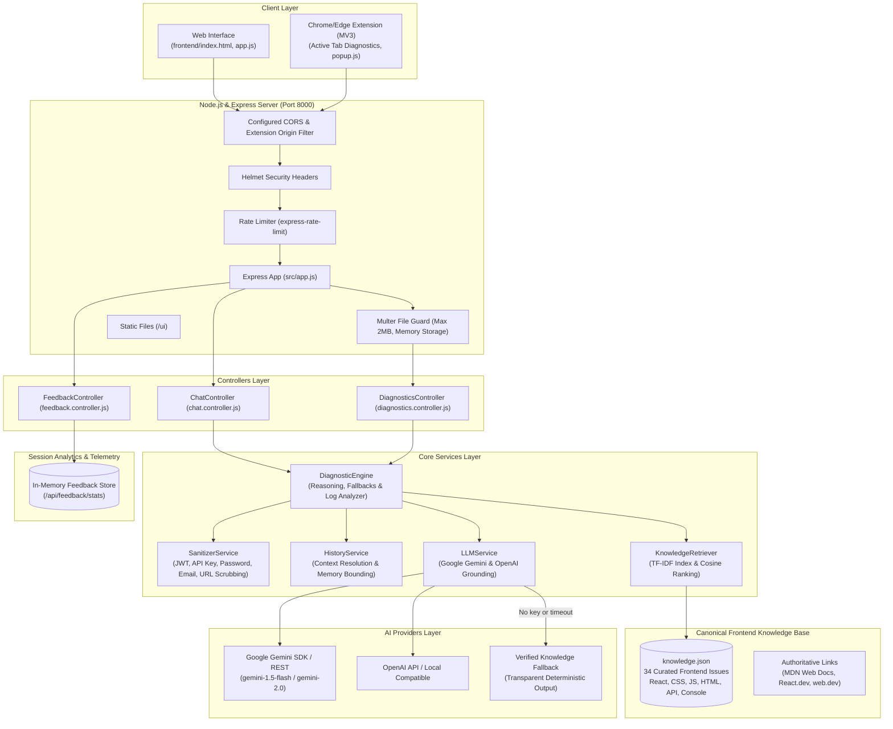
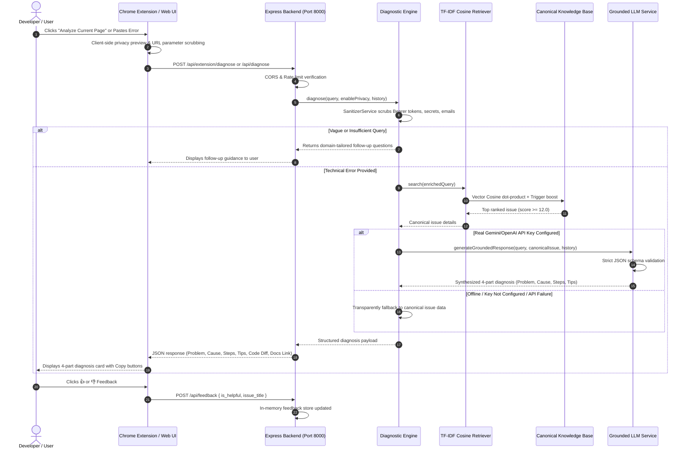

# 🏛️ FrontFix AI — System Architecture Specification
> **Team B (Frontend Support) — Node.js & Express Architectural Blueprint**

---

## 1. End-to-End System Architecture Diagram

---

## 2. Diagnostic Lifecycle Sequence Diagram

---

## 3. Component Breakdown

### A. Web Presentation (`frontend/`)
- Pure vanilla ES6 JavaScript with native Web APIs (`fetch`, `FileReader`, `Clipboard`).
- Dual online/offline mode: when the Node.js API is reachable, queries are routed through the backend engine; when offline, a local browser cache handles baseline queries.
- Zero bulky external frameworks (React/Vue/Angular omitted from UI bundle following the ponytail philosophy).

### B. Chrome/Edge Extension (`extension/`)
- Manifest V3 architecture (`activeTab`, `scripting`, `storage` permissions).
- **In-Page Monitor (`injected.js`)**: Runs in the host page context to intercept uncaught errors (`window.addEventListener('error')`), unhandled promise rejections (`unhandledrejection`), and failed resource fetches (`<script>`, `<link>`, ``).
- **Content Script (`content.js`)**: Bridges messages between page monitor and extension popup, captures user-selected text on demand, and maintains an in-memory ring buffer (max 20 errors).
- **Popup Interface (`popup.html`, `popup.js`, `popup.css`)**: Shows active tab URL, preview of detected errors, privacy toggles, "Analyze Current Page" trigger, manual error paste input, 4-part diagnosis cards, code diffs, and thumbs up/down feedback.
- **Privacy First**: Never captures form inputs, passwords, or cookies. Automatically redacts query parameters and tokens from URLs.

### C. Node.js & Express Backend (`backend/`)
- **Runtime**: Node.js LTS (ES Modules).
- **Security**: Helmet HTTP headers, strict CORS configuration supporting both web origins and `chrome-extension://*` IDs, rate limiting (60 req/min for diagnostics, 20 req/min for uploads).
- **Log File Ingestion**: Multer memory storage with 2MB hard limit (HTTP 413) and binary null-byte detection.
- **Knowledge Retrieval Engine**: True TF-IDF vector space model with smoothed inverse document frequency:
  $$\text{IDF}(t) = \ln\left(\frac{N + 1}{\text{DF}(t) + 1}\right) + 1.0$$
  $$\text{TF}(t, d) = \frac{\text{count}(t, d)}{\sum_{t'} \text{count}(t', d)}$$
  $$\text{CosineSim}(Q, D) = \frac{\vec{Q} \cdot \vec{D}}{\|\vec{Q}\| \|\vec{D}\|}$$
- **LLM Grounding Service**: Google Gemini 1.5 Flash SDK (`@google/generative-ai`) and OpenAI compatibility, with placeholder key detection, strict JSON schema validation, timeout protection, and automatic fallback.
- **In-Memory Telemetry**: Non-blocking feedback storage accessible via `GET /api/feedback/stats`.
